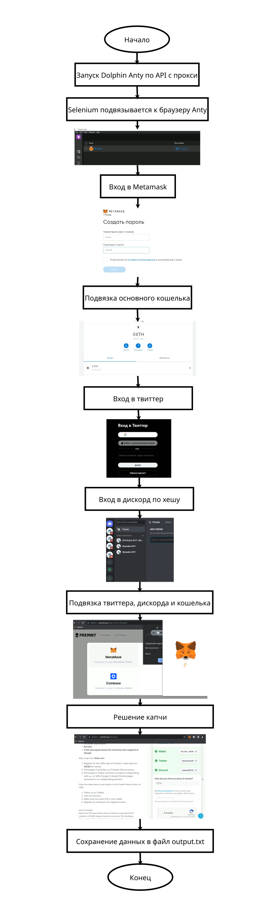
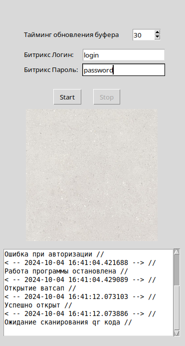
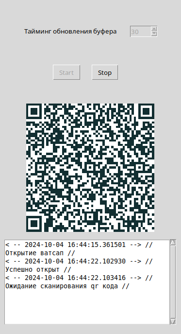
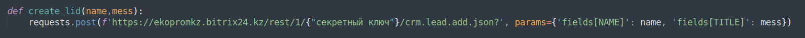
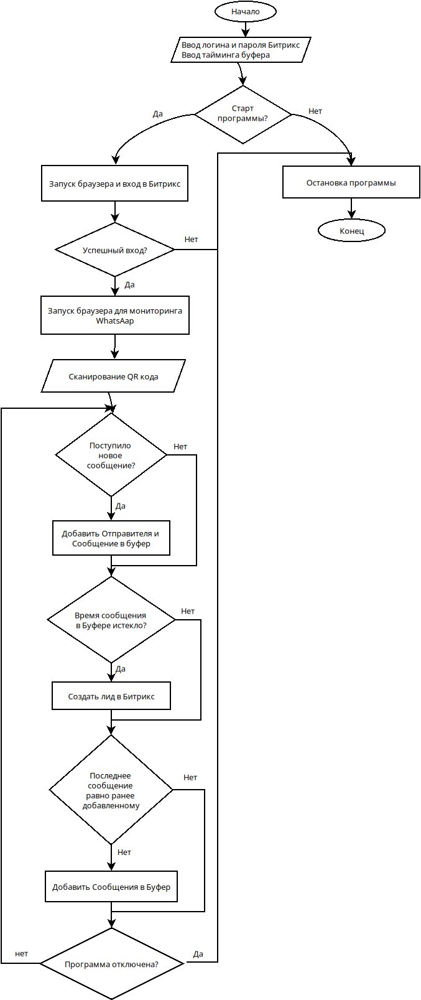
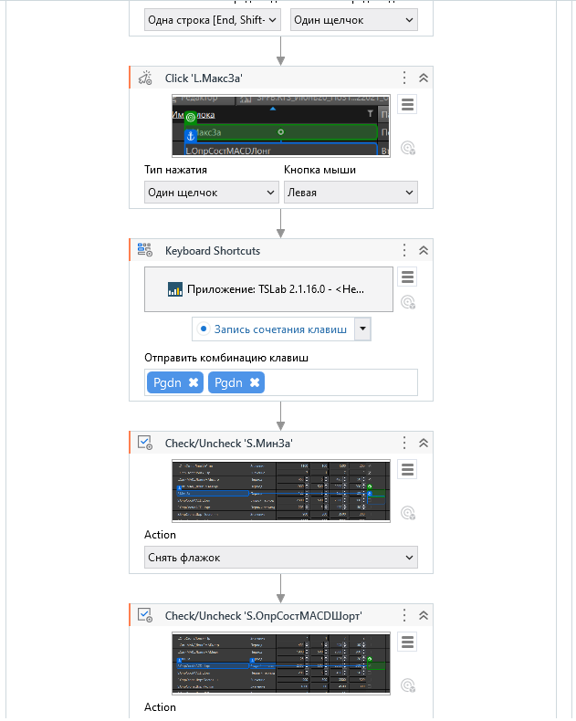
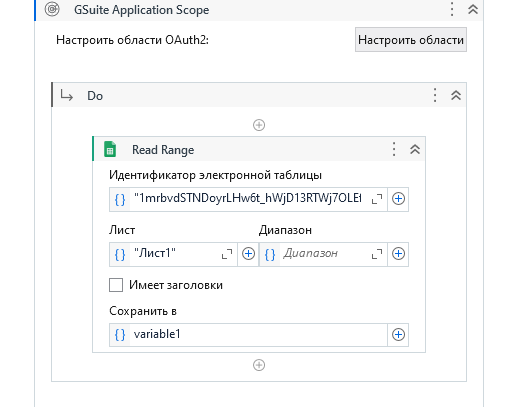
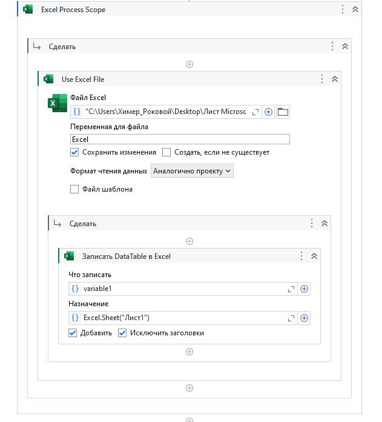

<h1>Демонстрационные Python скрипты.</h1>
 
<h1>nft_drawing</h1>
<h3>Описание</h3>

Скрипт на python для участия в розыгрыше NFT на сайте premint. Использует dolphin anty через api и прокси. Selenium подвязывается к dolpin anty. 
  Создает кошелек в metamask, подвязывает сторонний кошелек к созданному. Авторизуется в твиттер, дискорд по хешу. На сайте premint подвязывает твиттер, дискорд и метамаск. Решает капчу и сохраняет данные в output.txt

Должны быть заполнены файлы:

<ul>
  <li>Dolphin_Enty_auth</li>
  <li>proxy</li>
  <li>дискорды</li>
  <li>Приват ключи</li>
  <li>твиттеры</li>
</ul>

Также необходимо заполнить ключ и ключ вэбсайта premint для решения антикапчи

В dolphin anty должен быть установлено разширение metamask

При старте укажите количество итераций

<h3>Алгоритм работы</h3>

 
 
<h1>whatsapp_web_to_bitrix</h1>
<h2>Программа для создания лидов в Битрикс 24 из сообщений с Whatsapp Web</h2>
 
<h3>Описание</h3>

Скрипт на Python с графическим интерфейсом библиотеки Tkinter и автоматизацией браузера Selenium в headless(скрытом) режиме. Программа парсит новые сообщения с Ватсапп Вэб и при поступлении новых сообщений создает лид в системе Битрикс 24. Присутсвуют 2 реалиции, первая с запуском двух браузеров, вторая с запуском обного для Ватсапп Веб, а лиды создаются простым post запросом.

 
<h2>Как пользоваться?</h2>
<h3>Первая реализация</h3>

Введите логин и пароль от Битрикс 24. Также введите тайминг обновления буфера в секундах. Новые сообщения падают в буфер, по истечении времени создаентся лид из Имени контакта и Сообщения (Сообщений). После входа в Битрикс, скрипт предложит вам  отсканировать qr код Ватсапп Вэб. После успешного входа, при поступлении нового сообщения, сообщение падает в буфер. По истечении времени, из сообщений строится лид в Битрикс 24. Для чего нужен Буфер? Для того, чтобы не отправлять все сообщения от адресата в Битрикс, а по необходимости накопить сообщения и создать лид. Ваши сообщения не попадают в буфер, также изображения и голосовые сообщения. Внизу пишется небольшой лог последних действий. Также лог пишется в тестовый файл.

<h3>Вторая реализация</h3>

Тот же алгоритм работы, но второй браузер для Битрикса не запускается. Создание лидов осуществляется не через браузер, а через post запрос к серверу битрикса. Вам необходимо сформировать строку запроса в которой вы укажете свой секретный ключ. Получить его можете с админки Битрикса.

В коде пропишите свой секретный ключ

Вторая реализация полегче, что обеспечивает меньшую вероятность возникновения ошибки.

<h2>Алгоритм работы</h2>

 
 
<h1>twitter_api_registration</h1>
<h3>Описание</h3>

Скрипт на python для массового создания twitter api. Для работы необходимо иметь твиттер аккаунты и привязанную почту. Записать логины и пароли в файлы "twitter" и "хотмейл". Используется почта outlook через браузер. На почту приходят верифиционные 
коды, которые бот забивает в твиттер. Используется библиотека selenium для автоматизации процесса.

В каталоге "driver" версия скрипта с watchdog таймером, который сбрасывает попытку регистрации api при условии, что время веделенное на одну регистрацию превышает выделенный порог.

В каталоге "driver + dolphin anty" версия скрипта с антидетект браузером и использованием его api.

В каталоге "driver pravki" версия скрипта без watchdog таймера.

Все действия заключены в функции, в которых прописано с каким типом html элемента необходимо взаимодействовать, а также содержание контейнера и обработка ошибок.

 
 
<h1>TSLab_UIPath</h1>
<h3>Описание</h3>

Скрипт на UIPath для расчета данных с TSLab и запись в google таблицу.

В папке <a href="./TSLab_UIPath/Задание">Задание</a> -> видеоописание о том, как работает скрипт.

В архиве "TSLab" -> скрипт торгового бота и исторические данные.

В архиве "UIPath" -> основной скрипт RPA.

В архиве "Пример" -> пример работы с таблицами, чтение и запись.

В папке <a href="./TSLab_UIPath/vid">vid</a> -> видеоописание работы скрипта.

pass:path

 
 
<h1>pdfToTxt_detectLand</h1>
<h3>Описание</h3>

Скрипт на pythoт для перевода pdf файла в текст и определением языка написания. Используеся модуль tesseract для перевода в текст и библиотека detectlang для определения языка. Tesseract должен быть установлен и путь к нему необходимо прописать в 
скрипте.

Результат выглядит следующим образом:

 
 
<h1>chit_test</h1>
<h3>Описание</h3>

Скрипт на python для создания базы ответов на вопросы онлайн тестов в сайта rsmu.ru.

Бот авторизуется в системе:

Отвечает на вопрос и завершает тест. Проверяет результат вопроса -> правильный или нет.

Правильный записывает в файл output.xlsx лист true, не правильный в лист not.

После того, как база вопросов собрана, можно привести ее в читабельный вид с помощью скриптов gen_html и gen_pdf

Сохраненные картинки сохраняются в папку img.

Скрипт также проверяет отвечен ли был вопрос ранее и если отвечен, то отвечает на него. 
  Не правильные ответы тоже учитываются при ответе.

 
 
<h1>chit_pdd</h1>
<h3>Описание</h3>

Скрипт на python для сохранения вопросов и правильных ответов с сайта ПДД pddtest.kz

Введите пароль и логин к системе Jupyter Notebook соответсвенно в input_id

После начала работы, скрипт отвечает на вопросы. Если ответ правильный, сохраняет его в otvet.json. Также сохраняет видео вопроса в папку vid. 
  Затем, после выполнения нескольких итераций, необходимо запустить to_html. Этот скрипт создает разметку для html файла out.html.

<a href="./chit_pdd/vid/2023-02-28 22-15-19.mkv">Видео работы</a>
 
 
<h1>Bot_of_Thrones</h1>
<h3>Описание</h3>

Скрипт на python для автоматического прохождения браузерной игры "Игра Престолов"

Использует модуль OpenCV для сопоставления: скрин участка игры (анкер на который нужно ссылаться для нажатия ) -> тот участор экрана, на который необходимо нажать.

В папке jupyter -> для Jupyter Notebook. В папке script -> собранный скрипт на python.

